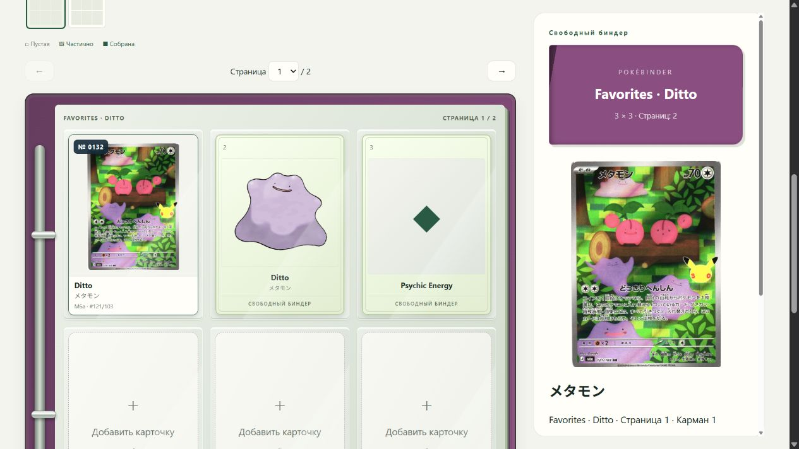
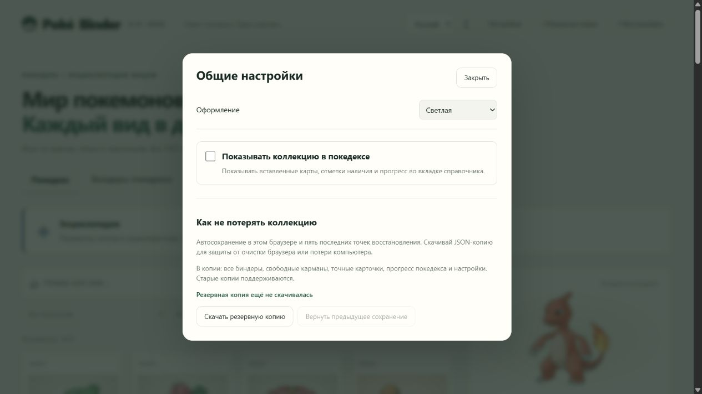
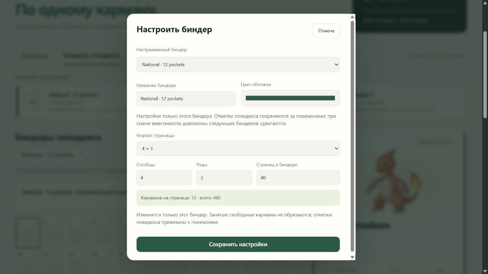
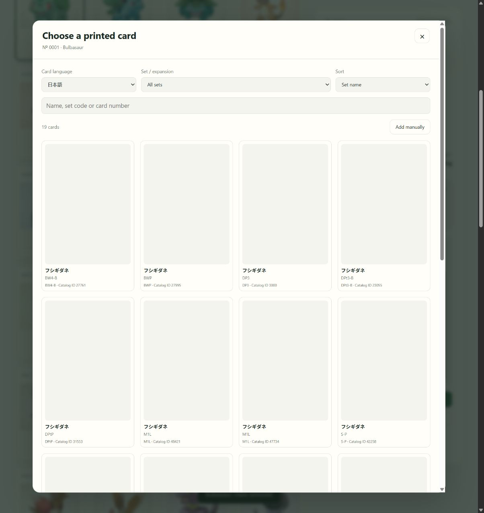

# PokéBinder

**Your collection. Your binders. Your way.**

Build a National Dex or arrange a personal collection, pocket by pocket.

English · 日本語 · Русский

[Quick start](#quick-start) · [User guide](docs/user-guide.md) · [Changelog](CHANGELOG.md)

## A collection you can see

| Feature | What it does |
| :--- | :--- |
| Pokédex encyclopedia | Browse 1025 species with standard artwork, English/Japanese names, types and facts. Optionally show your collection here. |
| Pokédex binders | Follow National-number order across binders with different formats and capacities. |
| Free binders | Place Pokémon, duplicates or custom named cards in any pocket. Move and swap cards across pages. |
| Individual setup | Give every binder its own name, cover color, columns, rows and page count. |
| Exact printed cards | Choose a printing by language and set; retain its species number, names and printing code beside the card front. |
| Visible progress | See per-binder statistics and compact page maps with filled pockets. |
| Three languages | English, Japanese and Russian UI; search across all supported names regardless of UI language. |
| Your own data | Browser-local saving, five recovery points and portable JSON backups. |

Light and Pokédex Dark themes are included. Printed cards tilt with your mouse; touch and reduced-motion preferences keep them still.

No account, app server, build step or third-party JavaScript dependencies are needed to use the prepared app.

## Quick start

Clone the repository and download primary species artwork once:

~~~sh
git clone https://github.com/KamiyaRei/pokebinder.git
cd pokebinder
node scripts/prepare.cjs --images
~~~

Preparation requires **Node.js 22 or newer** and an internet connection. Open **index.html** in your browser, or double-click **open.cmd** on Windows. Afterwards, the encyclopedia, primary artwork, Japanese bundled catalog and collection tracking work offline. Printed-card images and new English searches need internet unless cached.

Artwork is excluded from Git. Existing prepared copies containing assets/ need no download.

## Two ways to collect

**Pokédex binders** continue the National Dex through each binder’s capacity. For example, a 4×3 binder with 40 pages holds numbers 1–480; a following 3×3 binder with 40 pages holds 481–840. Changing dimensions preserves species marks and recalculates later positions.

**Free binders** are independent: add anything in any order, including duplicate Pokémon and named placeholders for trainers or energy. Click a pocket to edit it, drag within a page, or use **Move / swap** for another page. Resizing cannot cut off occupied pockets.

A page means **one side of a sheet**. The default 4×3 format has 12 pockets per page and 480 pockets per binder.

## Settings that stay in their place

| General preferences | Selected binder |
| :---: | :---: |
|  |  |

The header **Settings** controls appearance, the optional collection view in Pokédex and backup/recovery. **Edit binder** controls binder identity and dimensions.

## Choose the card in your pocket

In a Pokédex binder, open a Pokémon and choose its card. In a free binder, add a Pokémon to a pocket and optionally select its printing. Choose English or Japanese, filter by set and confirm the edition/finish. Ordinary marks or generic Pokémon entries also work without an exact printing.

The bundled Japanese official index contains **17,534 entries**, captured on October 15, 2026. Detailed metadata is available for 1,188 entries; the remainder retains official names, set codes and image URLs. Missing collector numbers can be entered manually. Catalog IDs are labeled separately from printed collector numbers.

Japanese lookup also offers an online TCGdex archive and labeled supplementary records, including Ditto AR M6a 121/103 from [Card Labo](https://www.c-labo-online.jp/product/408773). English lookup uses [TCGdex](https://tcgdex.dev/). **Coverage is not complete for every historical printing or finish.** Images may be unavailable or shared by foil variants; manual records remain supported. See [source attribution](docs/third-party.md) and the [official import audit](data/japanese-catalog-audit.json).

## Keep your collection safe

Progress, exact choices, binders and preferences are stored in this browser. Download **Backup** regularly and use **Restore** to move to another browser, device or storage origin. Recovery points do not protect against browser data being cleared.

**Upgrading:** export a backup from your previous app and restore it in 0.10. Schema 1/2/3 imports are supported; new backups use schema 3. Earlier apps cannot restore the new binder data, so retain your older backup for rollback. When available in the same browser storage, 0.10 can read earlier local saves without modifying them. Image binaries are not included in backups.

## Development

Code lives in src/, bundled data in data/, validation in tests/, and documentation in docs/. Downloaded assets/ and personal collection exports are ignored by Git.

~~~sh
node tests/check.cjs --skip-images
node tests/binder-model.cjs
node tests/card-tilt.cjs
node tests/catalog.cjs
node tests/japanese-catalog.cjs
node tests/supplements.cjs
node scripts/preview.cjs
~~~

Run node tests/check.cjs without --skip-images to validate downloaded PNGs too. The optional preview runs at http://127.0.0.1:8765. HTTP and file-based apps use different browser-storage origins; transfer through Backup/Restore when switching.

## Data & credits

Created by [KamiyaRei](https://github.com/KamiyaRei).

Species artwork/data come from the [official Pokémon Pokédex](https://zukan.pokemon.co.jp/); English names and generations come from [PokeAPI](https://github.com/PokeAPI/pokeapi). Snapshot: October 15, 2026. Alternate forms share a species pocket.

Independent fan project. Pokémon artwork, names and trademarks belong to their respective owners. See [third-party attribution](docs/third-party.md). Screenshots show a demonstration collection.
