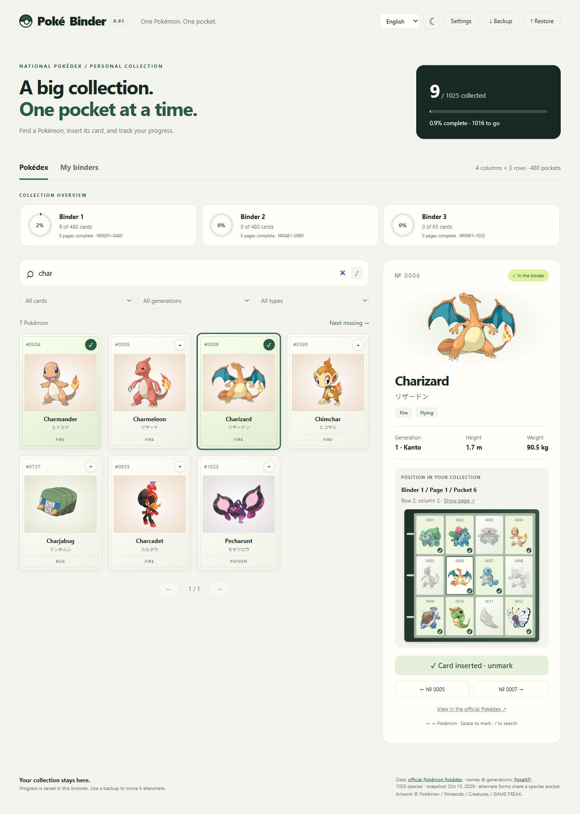
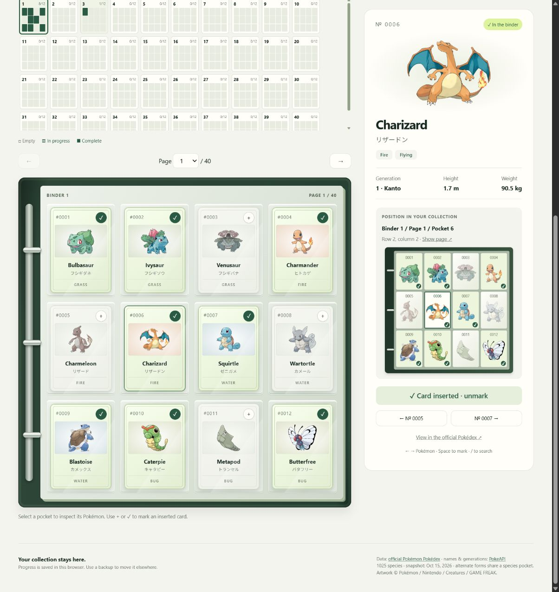
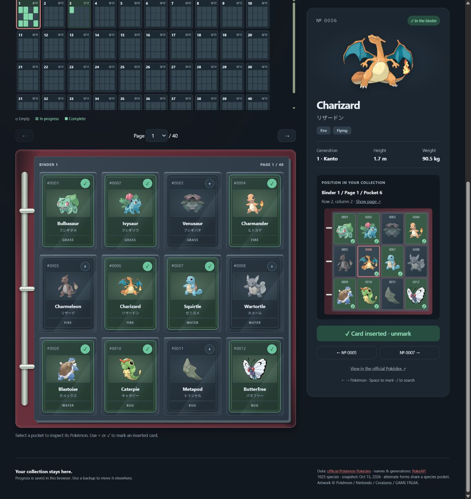
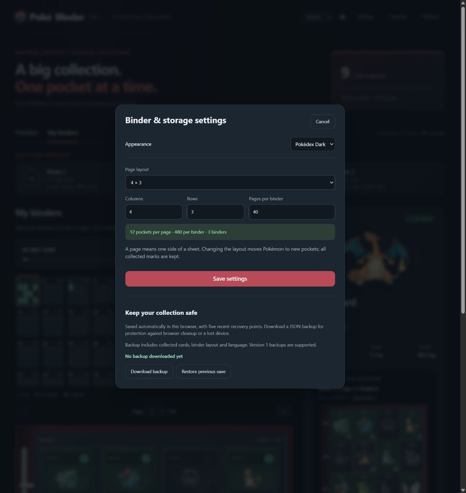

<div align="center">

# PokéBinder

**Your National Dex. Your physical binder.**

One Pokémon per pocket — with a place for every card you collect.

English · 日本語 · Русский

[Quick start](#quick-start) · [User guide](docs/user-guide.md) · [Changelog](CHANGELOG.md)

</div>



## A collection you can see

| Feature | What it does |
| :--- | :--- |
| National Pokédex | All 1025 species, with English and Japanese names, types and artwork. |
| Your binder layout | 4×3, 3×3, 2×2, 4×4 presets, or custom columns, rows and page counts. |
| A pocket for every Pokémon | National-number order, exact binder/page/pocket positions and previous/next navigation. |
| Visible progress | Collected cards stay in full color; missing cards are gently muted. Page maps show every filled pocket. |
| Three languages | English, Japanese and Russian interfaces. Search works across all available names. |
| Two themes | Light and Pokédex Dark, with a red binder shell and green collection indicators. |
| Your own data | Automatic local saving, five recovery points and portable JSON backups. |
| Exact printed cards | Optionally choose the actual card in each Pokémon's pocket, including set, collector number and finish. |
| Japanese card database | Bundled official search index with 17,534 entries; English lookup through TCGdex. |

No account, server, build step or third-party JavaScript dependencies are needed to use the prepared app.

## Inside the binder

| Light | Pokédex Dark |
| :---: | :---: |
|  |  |

<details>
<summary><strong>Binder layout and storage settings</strong></summary>



</details>

Screenshots show a demonstration collection, not a user's private progress.

## Choose the card in your pocket

Open a Pokémon → **Choose card**, select English or Japanese, filter by set and choose your printing. Its actual card front appears in the binder. Ordinary collected marks also work without a printing. You can enter a card manually, replace the printing or clear its link while keeping the collected mark.


The Japanese database contains all 450 pages of the official Pokémon-card search index captured on October 15, 2026: **17,534 entries**, including **19 Bulbasaur** and **315 Pikachu** cards. Japanese lookup works offline; card images load from the official website. English lookup uses TCGdex and needs internet for new searches.

Detailed metadata is available for 1,188 entries. Other entries retain their official names, set codes and image URLs; missing collector numbers can be entered from your card. Official catalog IDs are labeled separately from collector numbers. Historical coverage follows the source, and foil variations may share an image. See the [catalog guide](docs/user-guide.md#exact-printed-cards) and [import audit](data/japanese-catalog-audit.json).

## Quick start

Clone the repository and download the artwork once:

```sh
git clone https://github.com/KamiyaRei/pokebinder.git
cd pokebinder
node scripts/prepare.cjs --images
```

Preparation requires **Node.js 22 or newer** and an internet connection. Then open **`index.html`** in your normal browser, or double-click **`open.cmd`** on Windows. Afterwards, the primary artwork, Pokédex, search and collection tracking work offline. Downloaded artwork is excluded from Git; existing copies containing `assets/` need no download.

A page means **one side of a sheet**. The default 4×3 layout has 12 pockets per page and 40 pages per binder: 480 pockets. Double-sided sleeves mean 20 physical sheets. Changing the layout keeps collection marks and recalculates their positions.

## Keep your collection safe

Progress, exact-card choices, layout, language and theme are saved in this browser. Download a **Backup** regularly and use **Restore** when moving to another browser or device. Local recovery points cannot protect against browser data being cleared.

**Upgrading from 0.03 or 0.04:** export Backup in your previous app, then Restore in 0.05. This version uses the separate storage key `pokebinder.local.0.05`, preserving old saves. Both old schema 1 and current schema 2 backups are supported. Keep your original 0.03 backup for rollback: 0.03 cannot read exact-card schema 2 backups. Image binaries are not included in JSON backups.

See the [user guide](docs/user-guide.md) for storage details, keyboard controls and supported search names.

## Project layout

```text
pokebinder/
├── index.html            # Stable browser entry point
├── open.cmd              # Windows launcher
├── src/                  # App behavior, translations and styles
├── data/
│   ├── pokedex.js        # Prepared species dataset
│   ├── japanese-cards.js # Official Japanese printed-card index
│   └── source/           # Original species data snapshots
├── scripts/              # Dataset/artwork preparation and local preview
├── tests/                # Data, settings and collection checks
├── docs/                 # Guide, attribution and screenshots
└── .github/workflows/    # Automated checks
```

`assets/` is created by the preparation script and is ignored by Git. Personal backup files and local `.versions/` snapshots are ignored too.

## Development

```sh
node scripts/prepare.cjs         # Rebuild the dataset from bundled sources
node tests/check.cjs --skip-images
node tests/check.cjs             # Also validate downloaded PNGs
node tests/catalog.cjs           # Provider, matching and cache fixtures
node tests/japanese-catalog.cjs  # Official index and species associations
node scripts/preview.cjs         # Optional preview: http://127.0.0.1:8765
```

The checks exercise species data, multilingual search, layout boundaries, settings persistence, backup compatibility and recovery. Opening the app through HTTP uses a different browser-storage origin from the file-based app; export/import a backup when switching.

## Data & artwork

Species snapshot: October 15, 2026. Japanese data and primary artwork come from the [official Pokémon Pokédex](https://zukan.pokemon.co.jp/); English names and generations come from [PokeAPI](https://github.com/PokeAPI/pokeapi). Alternate forms currently share the species pocket.

Independent fan project. Pokémon artwork, names and trademarks belong to their respective owners. See [data and artwork attribution](docs/third-party.md).
